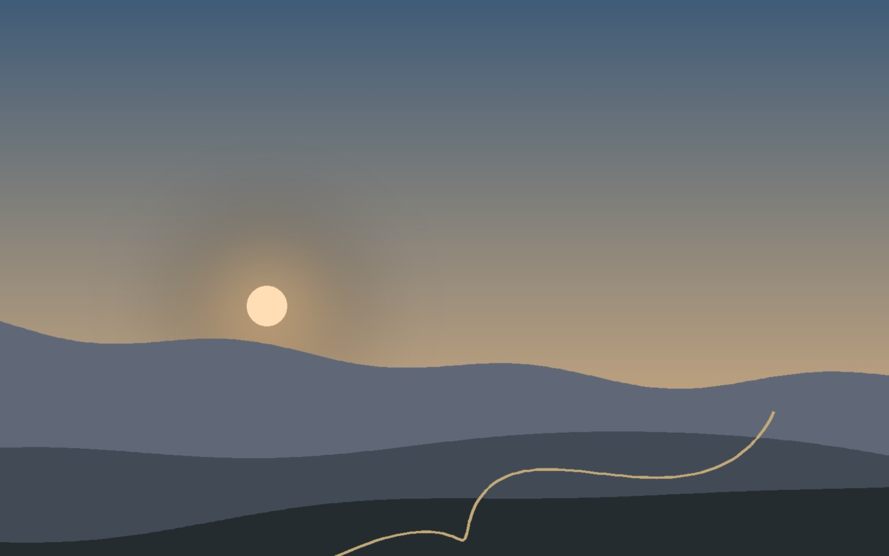

**Das ist ein Beispielbeitrag.** Er zeigt, wie eine Tour auf dieser Seite aussieht, und wird ersetzt, sobald die erste echte Tour online geht.

## Der Plan

Ein Overnighter ist die kleinste Form von Bikepacking: nach der Arbeit losfahren, irgendwo draußen schlafen, am nächsten Tag zurück. Hier steht, wie die Route entstanden ist, warum genau diese Ecke und was du dafür brauchst.

## Unterwegs

Die Geschichte der Tour: Wie lief der Abend, wo gab es Wasser, welcher Abschnitt war schöner als gedacht und welcher deutlich steiler.

## Schlafplatz

Ein paar Sätze zum Lager, zur Nacht und zum Frühstück mit Blick ins Tal.

## Was ich mitgenommen habe

- Zelt, Isomatte, Schlafsack
- Kocher und Kaffee
- Stirnlampe und Powerbank

Die GPX-Datei unter der Karte kannst du herunterladen und selbst fahren.
