Der Uckermark Ultra 400 ist ein Bikepacking-Event über zwei Tage: am ersten Tag rund 200 km von Bernau nach Neustrelitz, am zweiten Tag wieder zurück. Dazwischen eine Nacht im Event-Camp, für mich im Biwaksack.

## Tag 1: Bernau – Neustrelitz

Kurz vor sechs ging es in Bernau los. Die Strecke führte an diesem Tag viel über Sandwege, und das kostet auf Dauer Kraft.

Eine längere Pause habe ich in Himmelpfort gemacht. Danach bin ich nicht mehr allein gefahren, sondern zu zweit mit jemandem weiter.

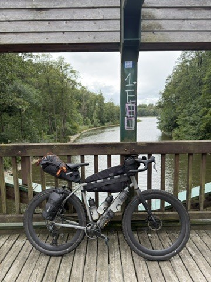 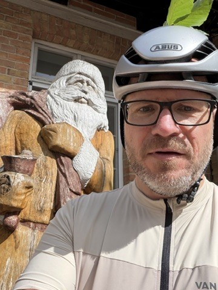

Gegen Ende des Tages fing es an zu regnen. Aus dem Sand wurde Schlamm, und die letzten Kilometer zogen sich entsprechend.

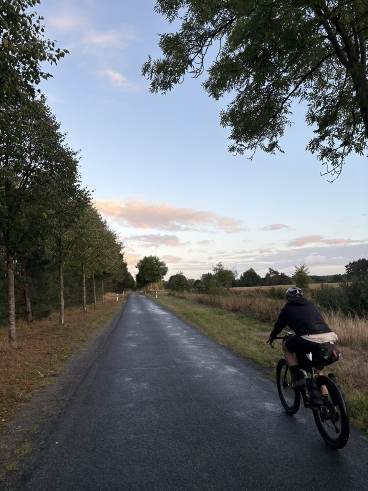 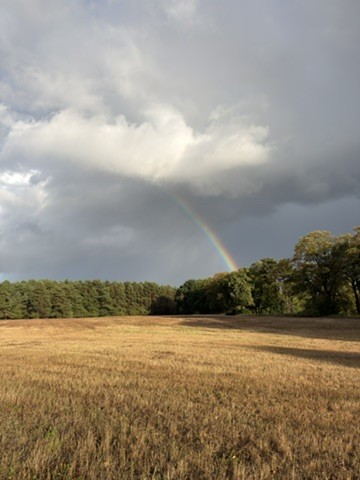

In Neustrelitz kamen wir im Dunkeln an: 209 km nach gut 15 Stunden.

## Die Nacht im Innenhof

Das Camp lag in einem Innenhof mitten in Neustrelitz. Im Gemeinschaftsraum gab es warme Suppe, und ich konnte mich dort erst einmal aufwärmen. Danach habe ich den Biwaksack im Innenhof ausgepackt. Die Nacht war recht ruhig. Nach einem kurzen Frühstück ging es um 7 Uhr wieder los.

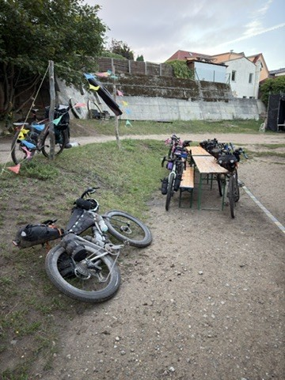

## Tag 2: Neustrelitz – Bernau

Der zweite Tag war deutlich entspannter, und landschaftlich fand ich ihn sehr viel schöner. Die Strecke führte durch dichte Wälder im Müritz-Nationalpark.

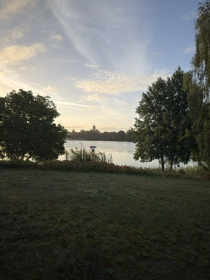 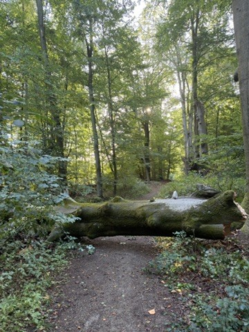

Die meiste Zeit bin ich an diesem Tag allein gefahren, habe aber immer wieder andere Leute getroffen.

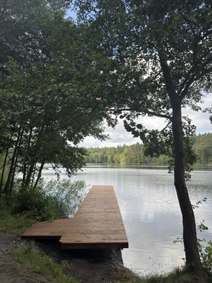 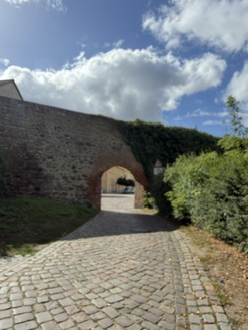

An einer Tankstelle bei Joachimsthal habe ich mit anderen Radfahrern Pause gemacht.

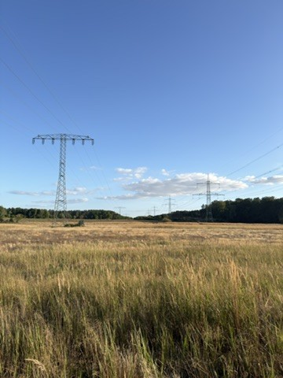 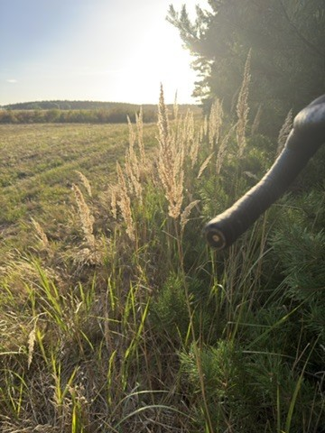

Die Zieleinfahrt in Bernau war dann wieder im Dunkeln: 200 km und 1305 Höhenmeter an diesem Tag.

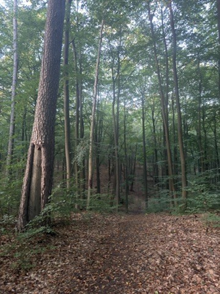
